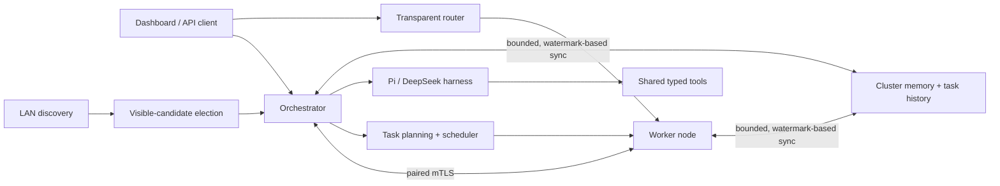

# mAIstr0

mAIstr0 is a local-first orchestrator for distributing LLM work across
machines on a LAN. It combines task planning and scheduling, a transparent
inference router, interactive Pi and DeepSeek harnesses, and synchronized
cluster memory. It does not require cloud inference.

Current version: **0.0.23**. See the [release notes](./changelog.md#0023---2026-10-24)
for sharding lifecycle validation, protected shard networking, and hardware
validation guidance.

## Quick start

Download the Windows or Linux archive from
[GitHub Releases](https://github.com/dbhaigh/mAIstr0/releases). Start the
application on the first machine; automatic startup looks for an existing
orchestrator, then elects one from the currently visible LAN candidates if
none is found. The elected machine also contributes a local worker.

PowerShell:

```powershell
.\maistr0.exe
```

bash:

```sh
./maistr0
```

On another machine, start a node and pair it with the orchestrator from the
dashboard's **Setup** panel. The default dashboard/API ports are `7450` for the
orchestrator and `7451` for a node. Pairing uses an out-of-band, one-time PIN;
see [Pairing and security](./docs/pairing-and-security.md).

PowerShell:

```powershell
.\maistr0.exe --role node --orchestrator-addr https://192.168.1.10:7450
```

bash:

```sh
./maistr0 --role node --orchestrator-addr https://192.168.1.10:7450
```

Use `--no-browser` to suppress automatic dashboard launch,
`--print-config` to inspect normalized configuration, or `--diagnostics` for
a prompt-free local health summary. See the
[configuration guide](./docs/configuration.md) for options and JSON examples.

## How it works



Election ranks candidates visible to each instance; it is not consensus, so a
network partition can produce a local winner on each side. Pairing establishes
certificate pins for remote cluster traffic. Read the
[architecture guide](./docs/architecture.md) for component boundaries and
failure assumptions.

## Documentation

- [Configuration](./docs/configuration.md) — roles, limits, engines, and
  configuration validation.
- [API reference](./docs/api.md) — task, inference, router, SSE, and metrics
  endpoints.
- [Pairing and security](./docs/pairing-and-security.md) — trust model,
  certificates, local dashboard boundary, and request limits.
- [Memory synchronization](./docs/memory-sync.md) — protocol behavior,
  compatibility, limits, and observability.
- [Development](./docs/development.md) — build, test, contracts, and release
  workflows.
- [Security policy](./SECURITY.md) — private vulnerability reporting.
- [MIT License](./LICENSE).
- [Contributing](./CONTRIBUTING.md) — pull-request and compatibility
  expectations.

The language-neutral HTTP and data contracts are in
[OpenAPI](./contracts/openapi.yaml), [JSON Schemas](./contracts/schemas/), and
the [porting guide](./contracts/PORTING.md). Current project changes are
recorded in the [changelog](./changelog.md).

## Sharding

A managed shard group runs one model across multiple machines. It is different
from distributing independent tasks or replicating a whole model on each node.
The **Shards** dashboard and `POST /api/shards` plan placement, reserve member
capacity, start workers before the head, and expose the ready head through
`POST /router/v1/chat/completions` using the group's model name.

- `llamacpp-rpc`: compatible RPC-enabled llama.cpp worker and head builds;
  heterogeneous supported GPUs are permitted. Configure a managed
  `ggml-rpc-server` on each selected node and a managed `llama-server` on at
  least one selected node. Pair the nodes and make their authenticated RPC
  relays reachable before creating the group.
- `vllm-mp`: Linux-only homogeneous GPU nodes, matching GPU counts and models,
  compatible vLLM builds, and a trusted private network. Configure a managed
  `vllm` on each node. The default topology uses tensor parallelism within a
  node and pipeline parallelism between nodes; non-head ranks are headless.
- Free **device** memory must fit weights, KV cache at the requested context,
  and a safety margin. Host RAM is not counted as GPU/NPU memory. The current
  group API does not enable CPU offload. NPU layer sharding requires explicit
  operator validation; a detected NPU is not proof of RPC support.

For example, after configuring and pairing two eligible workers, send this to
the local orchestrator's `POST /api/shards` (replace the model metadata and IDs
with the actual values):

```json
{
  "model": {
    "name": "my-sharded-model",
    "architecture": "llama",
    "parameters": 7000000000,
    "layer_count": 32,
    "hidden_size": 4096,
    "kv_heads": 8,
    "head_dim": 128,
    "vocab_size": 32000,
    "quantization": "q4_0",
    "file_size_bytes": 4000000000,
    "requested_context": 4096
  },
  "mode": "llamacpp-rpc",
  "pinned_nodes": ["worker-1", "worker-2"]
}
```

Creation returns `201` only when ready. Read `GET /api/shards` or
`GET /api/shards/{id}` for the plan, rationale, members, and state. Requests
within a group are serialized. Member/process loss first produces `degraded`;
the next health sweep tears down the group and marks it `failed`. Neither
state accepts inference. Rebuild by creating a new group with the same model
name after fixing the cause; a failed group may remain for diagnosis.
`DELETE /api/shards/{id}` stops the head before workers and removes the record.
Restart recovery verifies every member before restoring readiness.

The Go process integration tests prove control-plane lifecycle and routing with
fake engines, not tensor correctness, hardware compatibility, or throughput.
Record real-machine evidence in the
[hardware validation checklist](./docs/hardware-validation.md). See
[managed process configuration](./docs/configuration.md#managed-engine-processes),
the [planner](./docs/shard-planner.md), and
[troubleshooting](./docs/sharding-troubleshooting.md).

## Support matrix

These are runtime/build requirements, **not hardware certification**. All
real-machine combinations in the new validation checklist start untested.
An HTTP adapter can run on a different OS from its engine server.

- **llama.cpp (`llamacpp`), Linux / Windows / macOS**:
  CPU whole-model inference depends on a compatible build and model. GPU
  execution needs a matching backend: NVIDIA CUDA on Linux/Windows, AMD
  ROCm/HIP or Vulkan where supported, Intel Arc/iGPU Vulkan or SYCL where
  supported, or Metal on Apple silicon/macOS. RPC needs compatible RPC-enabled
  head/worker builds in addition to those device backends. CPU-only managed
  group placement is not currently enabled.
- **vLLM (`vllm`), Linux**:
  managed `vllm-mp` requires homogeneous GPUs and an appropriate upstream
  build (for example NVIDIA CUDA or AMD ROCm). CPU-only and NPU shard groups
  are not supported by this mode. Other standalone upstream backends are not
  evidence of mAIstr0 distributed support. **vLLM is not native on Windows**;
  a Windows mAIstr0 client may use a Linux server or a separately configured
  Linux/WSL environment. macOS managed vLLM is not supported.
- **Intel NPU (`llamacpp-openvino-npu`)**:
  experimental OpenVINO-enabled llama.cpp on an upstream-supported Intel
  Linux/Windows environment; requires compatible drivers, model quantization,
  and an explicit context cap. It is not an Apple/AMD/Qualcomm NPU backend.
  CPU/GPU use should select an appropriate ordinary engine profile instead.
- **AMD NPU (`llamacpp-xdna2-npu`, `fastflowlm-xdna2`)**:
  experimental, build/driver-specific Ryzen AI XDNA 2 paths. The enhanced
  llama.cpp/XRT profile is not a generic GPU or Windows NPU guarantee;
  FastFlowLM's Windows deployment has its own runtime requirements. Supported
  shapes, models, CPU fallback, and context limits differ. No macOS support
  is claimed. Neither profile enables NPU RPC sharding by default.
- **Snapdragon NPU (`llamacpp-hexagon-npu`)**:
  experimental Hexagon/HTP-enabled llama.cpp on the upstream-supported
  Snapdragon OS/SDK combination. This is not a claim of native Windows or
  macOS NPU support; validate the exact Android/Linux/Windows target against
  its build documentation. CPU/GPU and NPU execution are separate backends.
- **MLX (`mlx`), Apple silicon / macOS**:
  whole-model CPU/unified-memory GPU runtime via a compatible server; no
  mAIstr0 managed multi-node mode or NPU support is claimed.
- **Ollama, LM Studio, FastFlowLM, TGI, LocalAI, SGLang, and OpenAI-compatible
  servers**: mAIstr0 provides API adapters, not bundled runtimes or a common
  CPU/GPU/NPU support guarantee. Linux/Windows/macOS and accelerator support
  follow each server's build. These adapters do not imply managed shard-group
  or protocol-v2 partial-layer support.

## Engine configuration

Valid configured engine names include `ollama`, `vllm`, `llamacpp`,
`lmstudio`, `fastflowlm`, `tgi`, `localai`, `mlx`, `sglang`, `openai`,
`llamacpp-openvino-npu`, `llamacpp-hexagon-npu`, `llamacpp-xdna2-npu`, and
`fastflowlm-xdna2`.
These llama.cpp and FastFlowLM profile names use the OpenAI-compatible API.
The `vllm`, `llamacpp`, `lmstudio`, and `fastflowlm` engines also use that API.
Add an optional `api_key` to an engine configuration to send bearer
authentication; it is redacted from config dumps and never returned by node
or orchestrator APIs. The typed NPU profiles only advertise documented
vendor/backend capabilities; see the
[configuration guide](./docs/configuration.md#model-engines) for examples.

The `llamacpp-xdna2-npu` profile is an opt-in, experimental managed
llama-server build for AMD Ryzen AI XDNA 2 systems. It does not replace the
default llama.cpp engine; CPU fallback remains enabled for unsupported
operations. The current XDNA kernels cover only exact Q4_0 matrix-vector
shapes, and the measured XDNA-requested Qwen run was slower than CPU-only.
See the [XDNA deployment notes](./docs/configuration.md#amd-xdna-2-llama-cpp).

## Distributed shard network security

The control plane authenticates paired nodes with mutual TLS and pinned
certificates. The data planes used by distributed inference have different
security properties and must not be exposed to untrusted networks:

- llama.cpp RPC is an unauthenticated, unencrypted proof-of-concept protocol.
  mAIstr0 keeps each `ggml-rpc-server` on loopback and forwards worker traffic
  through a separate mutual-TLS relay authenticated with the paired nodes'
  pinned certificates. The head engine receives only local loopback relay
  addresses; configure the relay listener (`rpc_relay_listen_addr`, default
  `:7452`) so selected workers can reach it.
- vLLM's distributed traffic is unencrypted and can use dynamic ports. By
  default, each node requires `VLLM_HOST_IP` to resolve to a private address on
  an operator-trusted interface (`trusted_network_interfaces`). Run distributed
  vLLM over WireGuard or an isolated VLAN. Setting
  `allow_insecure_shard_network` is an explicit opt-out: it permits an
  otherwise untrusted interface and emits a prominent warning, but does not
  encrypt or authenticate vLLM traffic.

Mutual TLS on the llama.cpp relay does not make the underlying RPC protocol
safe to expose directly; firewall the RPC backend so only its local relay can
reach it. See the [network configuration details](./docs/configuration.md#managed-engine-processes).

## Threat model

The protected assets are model inputs/outputs and activations in transit,
cluster control authority, local model files, and the ability to launch
allow-listed engine processes. The remote attacker model includes an unpaired
LAN client, intercepted discovery traffic, and attempts to control processes
or send traffic directly to a shard backend.

- Pairing establishes pinned mutual-TLS identities, not trust in every machine
  on the LAN. Managed lifecycle calls additionally require the currently
  elected, paired orchestrator. Discovery/election does not authenticate peers
  or provide partition-safe consensus.
- llama.cpp RPC backends stay loopback-only behind the pinned mTLS relay.
  Do not publish their raw ports. vLLM distributed traffic is not protected by
  the HTTP control-plane TLS; use WireGuard or an isolated trusted VLAN and
  firewall its distributed ports. The insecure override is not a security fix.
- The local dashboard trusts the host user and loopback boundary. Do not expose
  it with an unauthenticated reverse proxy, shared port forward, or public
  tunnel. Keep PINs, certificates/private keys, and API keys out of logs.
- Binary/model allow-lists and typed argv constrain process selection; they
  do not sandbox an engine. Operators must trust the executable, model
  artifacts, driver stack, and every paired worker. A compromised paired host
  can observe its shard's data or return malicious results.
- Denial of service, malicious engine/model code, compromised administrator
  accounts, side channels, disk encryption, and cryptographic verification of
  model output are outside the current guarantees. Health checks and capacity
  limits improve availability but are not fault-tolerant inference.

See [pairing and security](./docs/pairing-and-security.md) for the complete
local/remote trust boundaries and [SECURITY.md](./SECURITY.md) for reporting.

## Sharding troubleshooting

Start with group `state`, `error`, and `rationale`, then inspect managed-engine
status on the member nodes. Common causes are missing RPC builds or relays,
untrusted vLLM interfaces, insufficient free device memory, incompatible
models/backends, and native Windows vLLM launches. A `degraded` group is not a
reduced-capacity service: wait for teardown, fix the cause, and rebuild.
The [troubleshooting guide](./docs/sharding-troubleshooting.md) includes
safe diagnostic steps and evidence to record before retrying.
