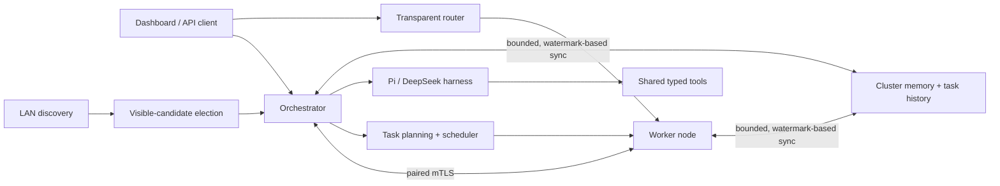

# mAIstr0

mAIstr0 is a local-first orchestrator for distributing LLM work across
machines on a LAN. It combines task planning and scheduling, a transparent
inference router, interactive Pi and DeepSeek harnesses, and synchronized
cluster memory. It does not require cloud inference.

## Quick start

Download the Windows or Linux archive from
[GitHub Releases](https://github.com/dbhaigh/mAIstr0/releases). Start the
application on the first machine; automatic startup looks for an existing
orchestrator, then elects one from the currently visible LAN candidates if
none is found. The elected machine also contributes a local worker.

PowerShell:

```powershell
.\maistr0.exe
```

bash:

```sh
./maistr0
```

On another machine, start a node and pair it with the orchestrator from the
dashboard's **Setup** panel. The default dashboard/API ports are `7450` for the
orchestrator and `7451` for a node. Pairing uses an out-of-band, one-time PIN;
see [Pairing and security](./docs/pairing-and-security.md).

PowerShell:

```powershell
.\maistr0.exe --role node --orchestrator-addr https://192.168.1.10:7450
```

bash:

```sh
./maistr0 --role node --orchestrator-addr https://192.168.1.10:7450
```

Use `--no-browser` to suppress automatic dashboard launch,
`--print-config` to inspect normalized configuration, or `--diagnostics` for
a prompt-free local health summary. See the
[configuration guide](./docs/configuration.md) for options and JSON examples.

## How it works



Election ranks candidates visible to each instance; it is not consensus, so a
network partition can produce a local winner on each side. Pairing establishes
certificate pins for remote cluster traffic. Read the
[architecture guide](./docs/architecture.md) for component boundaries and
failure assumptions.

## Documentation

- [Configuration](./docs/configuration.md) — roles, limits, engines, and
  configuration validation.
- [API reference](./docs/api.md) — task, inference, router, SSE, and metrics
  endpoints.
- [Pairing and security](./docs/pairing-and-security.md) — trust model,
  certificates, local dashboard boundary, and request limits.
- [Memory synchronization](./docs/memory-sync.md) — protocol behavior,
  compatibility, limits, and observability.
- [Development](./docs/development.md) — build, test, contracts, and release
  workflows.
- [Security policy](./SECURITY.md) — private vulnerability reporting.
- [MIT License](./LICENSE).
- [Contributing](./CONTRIBUTING.md) — pull-request and compatibility
  expectations.

The language-neutral HTTP and data contracts are in
[OpenAPI](./contracts/openapi.yaml), [JSON Schemas](./contracts/schemas/), and
the [porting guide](./contracts/PORTING.md). Current project changes are
recorded in the [changelog](./changelog.md).
