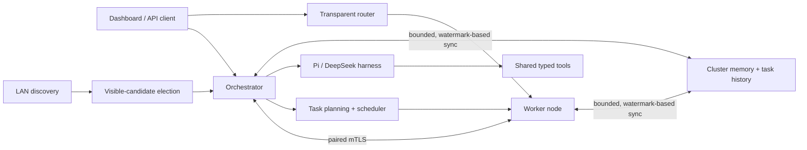

# mAIstr0

mAIstr0 is a local-first orchestrator for distributing LLM work across
machines on a LAN. It combines task planning and scheduling, a transparent
inference router, interactive Pi and DeepSeek harnesses, and synchronized
cluster memory. It does not require cloud inference.

Current version: **0.1.0**. See the [release notes](./changelog.md#010-2026-10-26)
for distributed-system correctness fixes, bounded concurrency and shutdown,
measured routing/dashboard improvements, reproducible benchmarks, and stronger
CI and package qualification. Before upgrading, review the
[security migration](./docs/pairing-and-security.md#migration): new pairing
requires verified certificate fingerprints and peer executable updates now
require explicit opt-in. Existing stored certificate pins remain compatible.

## Updating nodes and editing shard members

Nodes can opt into downloading strictly newer versions directly from paired
peers with `--allow-peer-updates` (off by default), then restart **only when
idle**. Stop active shard groups to allow replacement;
the updater never force-stops a running group. See
[peer updates and their accepted executable-trust risk](./docs/configuration.md#automatic-peer-executable-updates)
before enabling this on machines you do not fully trust.

On a shard-group card, select **Edit members**, check healthy nodes to add or
uncheck workers to remove, then choose **Apply and reload**. Missing RPC
runtimes install automatically. The current model head remains selected.
mAIstr0 drains current inference, unloads the group, recomputes comfortable
memory placement, then reloads workers and head using the **same group ID and
model**. There is a brief inference outage, not live migration; insufficient
remaining memory or runtime failures remain visible on the group. Correct the
selection and retry, or use **Start** after fixing the reported cause.

## Quick start

Published archives target Windows/Linux amd64. Source/service examples for
other platforms are not equivalent release or accelerator qualification.
See [benchmark and release acceptance](./docs/end-to-end-benchmarks.md) for
reproducible comparisons, package checks, and explicitly unmeasured benefits.

Download the Windows or Linux archive from
[GitHub Releases](https://github.com/dbhaigh/mAIstr0/releases). Start the
application on the first machine; automatic startup looks for an existing
orchestrator, then elects one from the currently visible LAN candidates if
none is found. The elected machine also contributes a local worker.

PowerShell:

```powershell
.\maistr0.exe
```

bash:

```sh
./maistr0
```

On another machine, start a node and pair it with the orchestrator from the
dashboard's **Setup** panel. The default dashboard/API ports are `7450` for the
orchestrator and `7451` for a node. New pairing requires an out-of-band verified
certificate SHA-256 fingerprint and a one-time PIN, including on the same subnet.
Peer executable updates default off; opt in only with `--allow-peer-updates`;
see [Pairing and security](./docs/pairing-and-security.md).

PowerShell:

```powershell
.\maistr0.exe --role node --orchestrator-addr https://192.168.1.10:7450
```

bash:

```sh
./maistr0 --role node --orchestrator-addr https://192.168.1.10:7450
```

Use `--no-browser` to suppress automatic dashboard launch,
`--print-config` to inspect normalized configuration, or `--diagnostics` for
a prompt-free local health summary. See the
[configuration guide](./docs/configuration.md) for options and JSON examples.

## How it works



Election ranks candidates visible to each instance; it is not consensus, so a
network partition can produce a local winner on each side. Pairing establishes
certificate pins for remote cluster traffic. Read the
[architecture guide](./docs/architecture.md) for component boundaries and
failure assumptions.

Dashboard state updates are built off the request path, coalesced during bursts,
and skipped when no clients are subscribed. Unchanged snapshots are not resent,
but newly connected dashboards still receive current state. Service shutdown
cancels background synchronization and upstream event streams before stores close.

## Documentation

- [Configuration](./docs/configuration.md) — roles, limits, engines, and
  configuration validation.
- [API reference](./docs/api.md) — task, inference, router, SSE, and metrics
  endpoints.
- [Pairing and security](./docs/pairing-and-security.md) — trust model,
  certificates, local dashboard boundary, and request limits.
- [Memory synchronization](./docs/memory-sync.md) — protocol behavior,
  compatibility, limits, and observability.
- [Development](./docs/development.md) — build, test, contracts, and release
  workflows.
- [Scheduler evaluation](./docs/scheduler-evaluation.md) — routing diagnostics,
  reproducible baseline comparisons, and measured policy tradeoffs.
- [Performance evaluation](./docs/performance-evaluation.md) — CPU/heap/trace
  coverage, reproducible workloads, measured sync improvements, and tradeoffs.
- [Concurrency and resource ownership](./docs/concurrency-ownership.md) — queue
  admission, cancellation, shutdown, resource cleanup, and retained limits.
- [Security policy](./SECURITY.md) — private vulnerability reporting.
- [MIT License](./LICENSE).
- [Contributing](./CONTRIBUTING.md) — pull-request and compatibility
  expectations.

The language-neutral HTTP and data contracts are in
[OpenAPI](./contracts/openapi.yaml), [JSON Schemas](./contracts/schemas/), and
the [porting guide](./contracts/PORTING.md). Current project changes are
recorded in the [changelog](./changelog.md).

## Sharding

A managed shard group runs one model across multiple machines. It is different
from distributing independent tasks or replicating a whole model on each node.
The **Shard groups** panel under Job routing shows group state and placement
details. Ctrl-click a healthy node in the cluster view to configure a group;
the orchestrator plans placement, reserves member capacity, starts workers
before the head, and exposes a ready head through
`POST /router/v1/chat/completions` using the group's model name.

- `llamacpp-rpc`: compatible RPC-enabled llama.cpp worker and head builds;
  heterogeneous supported GPUs are permitted. The wizard automatically
  installs missing `ggml-rpc-server` workers. Configure a managed `llama-server`
  with a compatible build and model on at least one selected node.
  Pair the nodes and make their authenticated RPC
  relays reachable before creating the group.
- `vllm-mp`: Linux-only homogeneous GPU nodes, matching GPU counts and models,
  compatible vLLM builds, and a trusted private network. Configure a managed
  `vllm` on each node. The default topology uses tensor parallelism within a
  node and pipeline parallelism between nodes; non-head ranks are headless.
- Free **device** memory must fit weights, KV cache at the requested context,
  and a safety margin. Host RAM is not counted as GPU/NPU memory. The current
  group API does not enable CPU offload. NPU layer sharding requires explicit
  operator validation; a detected NPU is not proof of RPC support.

### Create a shard group from the dashboard

1. Start the orchestrator and worker nodes and pair them. For `llamacpp-rpc`,
   have a compatible GGUF model installed in Ollama or LM Studio on at least
   one selected node; the wizard installs the runtime and configures its head.
   Existing operator-configured `llama-server` heads are also supported.
   For `vllm-mp`, configure vLLM on every selected node. See
   [managed engine configuration](./docs/configuration.md#managed-engine-processes).
2. Ctrl-click a healthy node in the cluster view to open **Create shard group**.
   Select the worker nodes and sharding mode. Every selected node must have the
   mode's managed worker engine. For llama.cpp RPC, selecting a node
   automatically downloads and verifies a missing worker; idle, automatically
   installed workers check for newer releases. Choose official llama.cpp or
   the custom XDNA release source. Unsupported platforms, missing releases,
   and failed verification are shown as errors, not skipped.
3. Choose the **Model head node**, a model, and its requested context length.
   For llama.cpp RPC, the picker reads existing managed heads and local Ollama
   or LM Studio GGUF files on that node. It configures the bundled matching
   `llama-server` when creating the group, without downloading or copying weights.
   For vLLM, it inspects configured local/cached Hugging Face metadata and weights.
   Models are offered only when their architecture and weight size can be read.
4. Choose **Create and start group**. The orchestrator calculates the placement
   from each device's current free memory, holds back a 2 GiB safety margin per
   device, and refuses the plan if the model weights and KV cache do not fit.
   For `llamacpp-rpc`, layer ranges are weighted by device capacity; vLLM
   requires homogeneous node resources and uses the configured parallel layout.
   The installed runtime refreshes actual free accelerator memory, including
   Vulkan devices. Unknown device memory is not replaced with host RAM and
   cannot receive layers.
5. The dialog reports the ready group and its assigned layers. The **Shard
   groups** panel under Job routing shows the group state and placement details.

The same create operation is available through the API. For example, after
configuring the engines and choosing eligible node IDs, send this payload to
`POST /api/shards` (replace the model metadata and IDs with actual values):

```json
{
  "model": {
    "name": "my-sharded-model",
    "architecture": "llama",
    "parameters": 7000000000,
    "layer_count": 32,
    "hidden_size": 4096,
    "kv_heads": 8,
    "head_dim": 128,
    "vocab_size": 32000,
    "quantization": "q4_0",
    "file_size_bytes": 4000000000,
    "requested_context": 4096
  },
  "mode": "llamacpp-rpc",
  "pinned_nodes": ["worker-1", "worker-2"]
}
```

Save the JSON as `shard-group.json` and submit it with
PowerShell's `curl.exe` (replace the URL with the orchestrator's listener URL):

```powershell
curl.exe --fail-with-body `
  -H "Content-Type: application/json" `
  --data-binary "@shard-group.json" `
  "http://127.0.0.1:7450/api/shards"
```

A successful request returns `201` with the ready group. Check `GET /api/shards`
or `GET /api/shards/{id}` for the plan, rationale, members, and state.

Requests within a group are serialized. Member/process loss first produces `degraded`;
the next health sweep tears down the group and marks it `failed`. Neither
state accepts inference. Rebuild by creating a new group with the same model
name after fixing the cause; a failed group may remain for diagnosis.
`DELETE /api/shards/{id}` stops the head before workers and removes the record.
Restart recovery verifies every member before restoring readiness.
Automatic llama.cpp heads are also checked against the saved model's name and
weight metadata. Starting a saved group restores its original local GGUF model
if another stopped group reconfigured the shared automatic head. If those
weights are no longer available, startup fails explicitly rather than running a
different model under the saved name. Runtime health checks and inference reject
mismatched heads; stop and start the group to restore the intended model.

### Use a shard group

If task planning or assignment reports **no compatible model**, mAIstr0 first
checks ready cluster models, then tries readable local GGUF weights on an idle
node. If none fit, it automatically downloads a recommended public Hugging Face
GGUF, verifies its size and SHA-256, installs a missing official llama.cpp
runtime, and starts a managed single-node group before retrying assignment.
This also works when no model is available for the initial planning step.
Active groups and operator-configured heads are never replaced.

The initial download recommendations are Qwen2.5 Instruct 3B and 7B Q4_K_M.
Downloads require internet access and roughly 2.1 GB or 4.7 GB of disk space
respectively; temporary download space is required until verification finishes.
The source repositories' model licenses still apply.
Only single-file public GGUF models are supported, not gated repositories,
arbitrary URLs, model scripts, or other weight formats. Placement still requires
known free GPU memory with the normal safety reserve and KV-cache allowance;
host RAM is not substituted for GPU memory. If every node is busy or the task
requires unsupported capabilities (for example vision), recovery returns an
explicit error rather than replacing a model or weakening the requirements.
See [model acquisition](./docs/api.md#compatible-model-acquisition) for manual
download and local-model selection.

1. Open **Shard groups** under **Job routing** and check that the group is
   **ready**. A failed or degraded group cannot answer prompts.
2. In dashboard **mAIstr0** chat, submit your request normally. Ready shard
   models are eligible for automatic planning, subtask execution, and final
   answer synthesis, alongside ordinary cluster models. Chat does not pin a
   specific group; scheduler selection still applies.
3. To explicitly select the group instead of using automatic task planning,
   send an OpenAI-compatible request to the orchestrator's
   `POST /v1/chat/completions` with the exact model name shown on its card.
   For example, save this as `shard-chat.json`, replacing `model` with your
   ready group's model:

   ```json
   {
     "model": "Llama-3.2-3B-Instruct-Q4_K_M",
     "messages": [
       {"role": "user", "content": "Rank ten classical composers and explain each ranking with examples."}
     ],
     "stream": false
   }
   ```

   ```powershell
   curl.exe --fail-with-body `
     -H "Content-Type: application/json" `
     --data-binary "@shard-chat.json" `
     "http://127.0.0.1:7450/v1/chat/completions"
   ```

The group is **one logical model**. Send prompts to the orchestrator, not to
individual shard workers. All requests share the head and are serialized,
including planning and synthesis; more shard members increase usable model
memory, not the number of independently running copies.

If chat reports `select planning model: scheduler: no compatible model for
subtasks: plan`, the planner could not find an eligible model; this is not an
error in the composer prompt. Update/restart the orchestrator to a build with
shard-task routing, verify that a group is **ready**, and submit again. Older
builds could route direct OpenAI requests to a shard head but could not use it
for task planning. If no group is ready, resolve its startup error or make a
normal cluster model available first.

If a working head times out with `Client.Timeout exceeded while awaiting headers`,
older task routing requested a non-streaming response: the head could be busy
generating without returning the completed answer before the fixed ten-minute
limit. Current builds consume streaming responses internally and flush proxy
chunks promptly. For a slow distributed model, set `dispatch_timeout_seconds`
to `1800` in the orchestrator configuration and restart with
`-orchestrator-config <path>` to allow thirty minutes. This also applies to
planning and synthesis. See [generation timeouts and progress](./docs/configuration.md#capacity-timeouts-and-synchronization).
The application log reports elapsed time and output/reasoning byte counts,
not private generated text. Low GPU utilization alone does not identify the
bottleneck: inspect the head's prompt-evaluation and generation timings and
worker/network behavior before assuming the model has hung.

Failed cards offer **Delete failed group**. This stops any remaining group
processes, releases its reservations, and removes the saved group. Errors are
displayed and the card is retained if cleanup fails. Deletion does not remove
downloaded runtimes or original model weights. Fix the reported cause and
Ctrl-click eligible nodes to create a replacement group.

### Stop, start, or restart a shard group

Use the buttons on its card under **Job routing → Shard groups**:

- **Stop** (ready/degraded): wait for active inference to finish, stop the head
  followed by the workers, and release member capacity. The group becomes
  **stopped**; its model, placement history, pinned nodes, and ID remain saved.
- **Start** (stopped/failed): retry the saved group with the same model and ID.
  Placement is recalculated using current device memory, preserving pinned
  nodes and the previous head selection when available. Workers start before
  the head. A ready group is eligible for inference and automatic tasks again.
- **Restart**: drain and stop the group, then replan and start it. It does not
  restart just the head or create a second group. A failed group can also be
  retried this way.

Controls are disabled while an operation is in progress. Startup may take up
to ten minutes for a large head. A stopped group is unavailable for new prompts
and remains stopped across application restarts. Stop/restart waits rather
than aborting active inference; queued/new requests may receive an unavailable
error once stopping begins. Cleanup/startup failures are shown on the card;
resolve the cause and retry. Engines in another group cannot be taken over.

The equivalent API calls use an empty request body:

```powershell
curl.exe --fail-with-body -X POST "http://127.0.0.1:7450/api/shards/GROUP_ID/stop"
curl.exe --fail-with-body -X POST "http://127.0.0.1:7450/api/shards/GROUP_ID/start"
curl.exe --fail-with-body -X POST "http://127.0.0.1:7450/api/shards/GROUP_ID/restart"
```

Each successful call returns `200` and the updated group. Start on a ready
group and stop on a stopped group are idempotent. Concurrent lifecycle
operations return `409`.

The Go process integration tests prove control-plane lifecycle and routing with
fake engines, not tensor correctness, hardware compatibility, or throughput.
Record real-machine evidence in the
[hardware validation checklist](./docs/hardware-validation.md). See
[managed process configuration](./docs/configuration.md#managed-engine-processes),
the [planner](./docs/shard-planner.md), and
[troubleshooting](./docs/sharding-troubleshooting.md).

## Support matrix

These are runtime/build requirements, **not hardware certification**. All
real-machine combinations in the new validation checklist start untested.
An HTTP adapter can run on a different OS from its engine server.

- **llama.cpp (`llamacpp`), Linux / Windows / macOS**:
  CPU whole-model inference depends on a compatible build and model. GPU
  execution needs a matching backend: NVIDIA CUDA on Linux/Windows, AMD
  ROCm/HIP or Vulkan where supported, Intel Arc/iGPU Vulkan or SYCL where
  supported, or Metal on Apple silicon/macOS. RPC needs compatible RPC-enabled
  head/worker builds in addition to those device backends. CPU-only managed
  group placement is not currently enabled.
- **vLLM (`vllm`), Linux**:
  managed `vllm-mp` requires homogeneous GPUs and an appropriate upstream
  build (for example NVIDIA CUDA or AMD ROCm). CPU-only and NPU shard groups
  are not supported by this mode. Other standalone upstream backends are not
  evidence of mAIstr0 distributed support. **vLLM is not native on Windows**;
  a Windows mAIstr0 client may use a Linux server or a separately configured
  Linux/WSL environment. macOS managed vLLM is not supported.
- **Intel NPU (`llamacpp-openvino-npu`)**:
  experimental OpenVINO-enabled llama.cpp on an upstream-supported Intel
  Linux/Windows environment; requires compatible drivers, model quantization,
  and an explicit context cap. It is not an Apple/AMD/Qualcomm NPU backend.
  CPU/GPU use should select an appropriate ordinary engine profile instead.
- **AMD NPU (`llamacpp-xdna2-npu`, `fastflowlm-xdna2`)**:
  experimental, build/driver-specific Ryzen AI XDNA 2 paths. The enhanced
  llama.cpp/XRT profile is not a generic GPU or Windows NPU guarantee;
  FastFlowLM's Windows deployment has its own runtime requirements. Supported
  shapes, models, CPU fallback, and context limits differ. No macOS support
  is claimed. Neither profile enables NPU RPC sharding by default.
- **Snapdragon NPU (`llamacpp-hexagon-npu`)**:
  experimental Hexagon/HTP-enabled llama.cpp on the upstream-supported
  Snapdragon OS/SDK combination. This is not a claim of native Windows or
  macOS NPU support; validate the exact Android/Linux/Windows target against
  its build documentation. CPU/GPU and NPU execution are separate backends.
- **MLX (`mlx`), Apple silicon / macOS**:
  whole-model CPU/unified-memory GPU runtime via a compatible server; no
  mAIstr0 managed multi-node mode or NPU support is claimed.
- **Ollama, LM Studio, FastFlowLM, TGI, LocalAI, SGLang, and OpenAI-compatible
  servers**: mAIstr0 provides API adapters, not bundled runtimes or a common
  CPU/GPU/NPU support guarantee. Linux/Windows/macOS and accelerator support
  follow each server's build. These adapters do not imply managed shard-group
  or protocol-v2 partial-layer support.

## Engine configuration

Valid configured engine names include `ollama`, `vllm`, `llamacpp`,
`lmstudio`, `fastflowlm`, `tgi`, `localai`, `mlx`, `sglang`, `openai`,
`llamacpp-openvino-npu`, `llamacpp-hexagon-npu`, `llamacpp-xdna2-npu`, and
`fastflowlm-xdna2`.
These llama.cpp and FastFlowLM profile names use the OpenAI-compatible API.
The `vllm`, `llamacpp`, `lmstudio`, and `fastflowlm` engines also use that API.
Add an optional `api_key` to an engine configuration to send bearer
authentication; it is redacted from config dumps and never returned by node
or orchestrator APIs. The typed NPU profiles only advertise documented
vendor/backend capabilities; see the
[configuration guide](./docs/configuration.md#model-engines) for examples.

The `llamacpp-xdna2-npu` profile is an opt-in, experimental managed
llama-server build for AMD Ryzen AI XDNA 2 systems. It does not replace the
default llama.cpp engine; CPU fallback remains enabled for unsupported
operations. The current XDNA kernels cover only exact Q4_0 matrix-vector
shapes, and the measured XDNA-requested Qwen run was slower than CPU-only.
See the [XDNA deployment notes](./docs/configuration.md#amd-xdna-2-llama-cpp).

## Distributed shard network security

The control plane authenticates paired nodes with mutual TLS and pinned
certificates. The data planes used by distributed inference have different
security properties and must not be exposed to untrusted networks:

- llama.cpp RPC is an unauthenticated, unencrypted proof-of-concept protocol.
  mAIstr0 keeps each `ggml-rpc-server` on loopback and forwards worker traffic
  through a separate mutual-TLS relay authenticated with the paired nodes'
  pinned certificates. The head engine receives only local loopback relay
  addresses; configure the relay listener (`rpc_relay_listen_addr`, default
  `:7452`) so selected workers can reach it.
- vLLM's distributed traffic is unencrypted and can use dynamic ports. By
  default, each node requires `VLLM_HOST_IP` to resolve to a private address on
  an operator-trusted interface (`trusted_network_interfaces`). Run distributed
  vLLM over WireGuard or an isolated VLAN. Setting
  `allow_insecure_shard_network` is an explicit opt-out: it permits an
  otherwise untrusted interface and emits a prominent warning, but does not
  encrypt or authenticate vLLM traffic.

Mutual TLS on the llama.cpp relay does not make the underlying RPC protocol
safe to expose directly; firewall the RPC backend so only its local relay can
reach it. See the [network configuration details](./docs/configuration.md#managed-engine-processes).

## Threat model

The protected assets are model inputs/outputs and activations in transit,
cluster control authority, local model files, and the ability to launch
allow-listed engine processes. The remote attacker model includes an unpaired
LAN client, intercepted discovery traffic, and attempts to control processes
or send traffic directly to a shard backend.

- Pairing establishes pinned mutual-TLS identities, not trust in every machine
  on the LAN. Managed lifecycle calls additionally require the currently
  elected, paired orchestrator. Discovery/election does not authenticate peers
  or provide partition-safe consensus.
- llama.cpp RPC backends stay loopback-only behind the pinned mTLS relay.
  Do not publish their raw ports. vLLM distributed traffic is not protected by
  the HTTP control-plane TLS; use WireGuard or an isolated trusted VLAN and
  firewall its distributed ports. The insecure override is not a security fix.
- The local dashboard trusts the host user and loopback boundary. Do not expose
  it with an unauthenticated reverse proxy, shared port forward, or public
  tunnel. Keep PINs, certificates/private keys, and API keys out of logs.
- Binary/model allow-lists and typed argv constrain process selection; they
  do not sandbox an engine. Operators must trust the executable, model
  artifacts, driver stack, and every paired worker. A compromised paired host
  can observe its shard's data or return malicious results.
- Denial of service, malicious engine/model code, compromised administrator
  accounts, side channels, disk encryption, and cryptographic verification of
  model output are outside the current guarantees. Health checks and capacity
  limits improve availability but are not fault-tolerant inference.

See [pairing and security](./docs/pairing-and-security.md) for the complete
local/remote trust boundaries and [SECURITY.md](./SECURITY.md) for reporting.

## Sharding troubleshooting

Start with group `state`, `error`, and `rationale`, then inspect managed-engine
status on the member nodes. Common causes are missing RPC builds or relays,
untrusted vLLM interfaces, insufficient free device memory, incompatible
models/backends, and native Windows vLLM launches. A `degraded` group is not a
reduced-capacity service: wait for teardown, fix the cause, and rebuild.
The [troubleshooting guide](./docs/sharding-troubleshooting.md) includes
safe diagnostic steps and evidence to record before retrying.
## Asking mAIstr0 about cluster status

The dashboard's **Ask mAIstr0** action answers read-only cluster-status
questions directly from the node inventory, health/capacity, recent-task,
shard-group, and version APIs. It does not call an LLM or create a task for
questions such as "What common LLMs are on the cluster?", "Which nodes are
offline?", or "What engines are running?". The answer includes reported model
names per node and their intersection across all online nodes. An offline
node or unavailable engine inventory makes availability on **all registered
nodes** unknown, not a successful match. Identical advertised model names are
not proof of identical weights, quantization, or revisions.

This is a snapshot report, not a new engine probe or a diagnosis of an
unreported failure. Missing telemetry and failed API reads are marked
explicitly. It also works when no nodes are healthy. Requests that change
state, such as installing models or restarting workers, remain on the task
path; ambiguous/general requests still use the workflow planner.

For work requiring automatic planning, malformed JSON or invalid task graphs
get one corrective retry on the selected model before trying another eligible
node/model. If every attempt fails, mAIstr0 reports the planning error rather
than silently substituting a heuristic plan. Model output is not echoed into
corrective prompts or logged.
