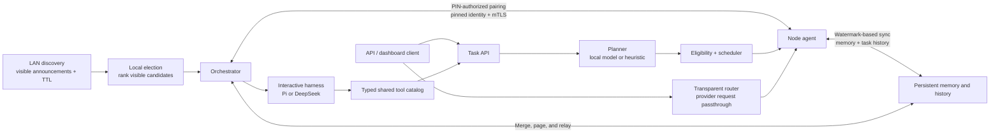

# Architecture

mAIstr0 is a local-first control plane for coordinating inference across a
trusted LAN. The diagram shows the main request paths and the cluster trust
boundary:

## Startup and trust

Automatic startup observes a discovery lease and chooses a role from the
currently visible candidates. Election is visibility-based, not consensus: a
network partition can produce a local winner on each side. Discovery alone
does not grant membership. Pairing establishes certificate pins, and remote
cluster traffic uses mutual TLS. See [Pairing and security](./pairing-and-security.md)
and [LAN election and partitions](./lan-election.md). For what the runtime
does and does not guarantee across failures and partitions, see
[Distributed-system guarantees and limits](./distributed-guarantees.md).

## Request paths

The separate `cmd/maistr0-bench` executable composes bounded HTTP workloads
through `internal/benchrun`; it does not start cluster services or inference
processes. [Measurement and release acceptance](./end-to-end-benchmarks.md)
documents engine-direct baselines, server observations, unavailable metrics,
correlated router diagnostics, and their deliberate scope limits.

- **Task API:** plans work as a dependency graph, filters eligible nodes, then
  schedules subtasks within orchestrator and node capacity limits.
- **Transparent router:** forwards provider-compatible requests without task
  planning or chat-tool translation. Its routing and retry boundaries are
  documented in the [API reference](./api.md).
- **Interactive harness:** Pi and DeepSeek share the agent-loop and typed tool
  catalog while retaining their own model adapters and message formats.
- **Memory sync:** nodes exchange memory and task history using bounded,
  watermark-based transfers with compatibility fallbacks. See
  [Memory synchronization](./memory-sync.md).

Pi is the default interactive harness. Its coordinator model is selected from
healthy nodes in the local cluster; no Pi CLI, API key, or cloud inference
service is required. Interactive sessions are persisted in the orchestrator's
memory database and restored after restart. Interrupting a turn cancels
downstream dispatches while preserving session state.

The runtime scheduler and router are coordinated through shared capacity and
readiness information. The score calculation itself is deterministic, but
network calls, model inference, and surrounding state management are not
lock-free.

## Node ownership boundaries

The [node composition root](../internal/nodeagent/agent.go) wires concrete owners
explicitly; components do not discover dependencies through `Agent`.

- [Execution accounting](../internal/nodeagent/executor_component.go) owns both
  execution slots and the count of active work. Its `activeMu` is a leaf lock,
  released before waiting for slots or invoking another component. Intentionally
  ungated inference/dialogue work still contributes to the count; this refactor
  does not expand the scope of `MaxConcurrentTasks`. Each successful acquisition
  still transfers exactly one release obligation to its caller.
- [Engine inventory](../internal/nodeagent/engine_component.go) owns adapters,
  inventory refresh, and runtime disabled/default model selection. `modelMu`
  protects both selection and the cached flags derived from it. Refresh probes
  run outside locks; publication applies the latest selection, including to
  retained last-good models. Lock order is `refreshMu` then `modelMu`, with no
  dependency on the general agent-state mutex.
- [Telemetry](../internal/nodeagent/telemetry_component.go) remains responsible
  for hardware probes and usage history, not model policy.
- [General node state](../internal/nodeagent/components.go) retains configuration
  and peer membership. The configuration's model fields are startup seeds, not
  authoritative runtime selection; HTTP adapters obtain current selection from
  the inventory owner. No storage/configuration schema has changed.

### Responsibility-based refactoring assessment

The highest-value remaining boundary was the shared node state: an executor
needed that entire owner solely to count work, while inventory and properties
handlers independently manipulated model policy. These dependencies complicated
isolated tests and allowed selection flags to diverge during refresh. Moving
state to the existing owners removes one executor state-pointer dependency and
one three-method inventory state interface, without adding packages or interfaces.
Selection flag calculation now has one implementation instead of three.

Domain tests in [component tests](../internal/nodeagent/components_test.go) and
[execution tests](../internal/nodeagent/execution_ownership_test.go) need no
listeners, persistence, subprocesses, or hardware probes. They characterize
mixed gated/ungated accounting, saturation/cancellation, concurrent releases,
selection changes during blocked probes, snapshot isolation, and concurrent
selection/publication. HTTP-level cases preserve the different omission rules:
properties retains an omitted/null disabled list, while the models endpoint
clears it; empty defaults retain the existing default.

Two tightly coupled defects are corrected: default-only properties updates now
update cached flags, and a slow inventory refresh cannot publish obsolete
selection flags. Routes, payloads, validation policy, persisted formats, refresh
TTL/generation rules, last-good inventory, and lifecycle ownership are unchanged.

Other reviewed complexity is deliberately retained:

- The orchestrator's [harness owner](../internal/orchestrator/harness_component.go)
  coordinates sessions and turn cancellation through existing backend/store
  boundaries. Splitting these by file size would not establish a new owner.
- [Shard lifecycle](../internal/orchestrator/shard_manager_lifecycle.go) must
  coordinate operations, reservations, partial startup, and cleanup. Its existing
  planner/store/engine-control boundaries are preferable to splitting a single
  lifecycle across several owners.
- HTTP handlers remain transport adapters; engine probing, selection, and
  accounting stay with domain owners. Hardware telemetry is not merged into
  inventory merely because both publish status.

See [ownership and measurements](./concurrency-ownership.md#phase-7-ownership-comparison)
for the before/after comparison and validation.
