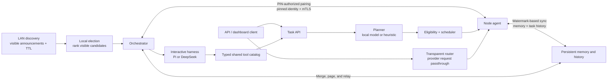

# Architecture

mAIstr0 is a local-first control plane for coordinating inference across a
trusted LAN. The diagram shows the main request paths and the cluster trust
boundary:

## Startup and trust

Automatic startup observes a discovery lease and chooses a role from the
currently visible candidates. Election is visibility-based, not consensus: a
network partition can produce a local winner on each side. Discovery alone
does not grant membership. Pairing establishes certificate pins, and remote
cluster traffic uses mutual TLS. See [Pairing and security](./pairing-and-security.md)
and [LAN election and partitions](./lan-election.md).

## Request paths

- **Task API:** plans work as a dependency graph, filters eligible nodes, then
  schedules subtasks within orchestrator and node capacity limits.
- **Transparent router:** forwards provider-compatible requests without task
  planning or chat-tool translation. Its routing and retry boundaries are
  documented in the [API reference](./api.md).
- **Interactive harness:** Pi and DeepSeek share the agent-loop and typed tool
  catalog while retaining their own model adapters and message formats.
- **Memory sync:** nodes exchange memory and task history using bounded,
  watermark-based transfers with compatibility fallbacks. See
  [Memory synchronization](./memory-sync.md).

Pi is the default interactive harness. Its coordinator model is selected from
healthy nodes in the local cluster; no Pi CLI, API key, or cloud inference
service is required. Interactive sessions are persisted in the orchestrator's
memory database and restored after restart. Interrupting a turn cancels
downstream dispatches while preserving session state.

The runtime scheduler and router are coordinated through shared capacity and
readiness information. The score calculation itself is deterministic, but
network calls, model inference, and surrounding state management are not
lock-free.
