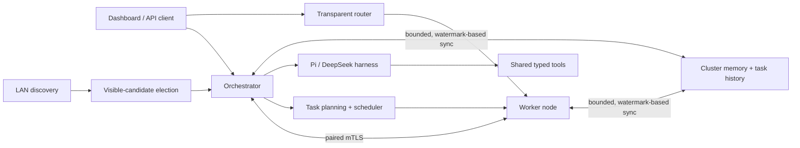

# Synchronization and runtime overview

## How it works

Election ranks candidates visible to each instance; it is not consensus, so a
network partition can produce a local winner on each side. Pairing establishes
certificate pins for remote cluster traffic. Read the
[architecture guide](./architecture.md) for component boundaries and
failure assumptions.

Dashboard state updates are built off the request path, coalesced during bursts,
and skipped when no clients are subscribed. Unchanged snapshots are not resent,
but newly connected dashboards still receive current state. Service shutdown
cancels background synchronization and upstream event streams before stores close.
